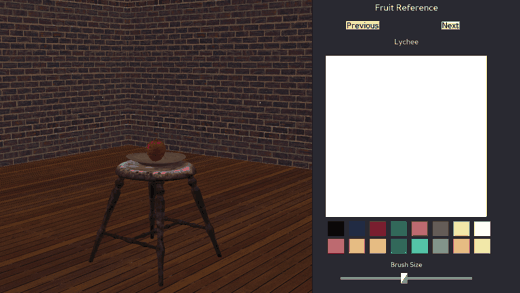

# Still Life Painter

A 3D art-studio painting minigame built with **Panda3D**. The screen is split: a
3D studio (walls, floor, a stool with a plate and a piece of fruit) on the left,
and a painting canvas with a fruit selector, colour palette and brush-size slider
on the right. Orbit the camera around the fruit and paint what you see.



## Features
- Split-screen: live 3D studio + a paintable 2D canvas.
- Orbit / raise / zoom the camera around the still-life pivot.
- Colour palette + brush-size slider; paint strokes on the canvas.
- Fruit reference selector (Previous / Next).
- Pause menu (Resume / Clear Canvas / Exit) — painting can't be undone, only cleared.

## Controls
| Input | Action |
|-------|--------|
| A / D | orbit the camera left / right |
| W / S | raise / lower the camera |
| ↑ / ↓ | zoom in / out |
| Left mouse (drag on canvas) | paint |
| Esc | pause menu |

## Run
```bash
pip install panda3d panda3d-gltf
python still_life_painter.py
```
First put the Poly Haven files listed below in an `assets/` folder next to
`still_life_painter.py`. If a file is missing, the game lists it and exits.

## A note on assets
The studio models and textures are **CC0** from [Poly Haven](https://polyhaven.com)
(fruit `.glb` models, wood/brick textures). They are **not bundled** in this repo —
download the CC0 originals from Poly Haven and place the `.glb` models and textures
in an `assets/` folder next to `still_life_painter.py`.

The game looks for these files in `assets/` (each name starts with the asset's
Poly Haven ID):
- Textures: `plank_flooring_04_diff_4k.jpg`, `brick_wall_10_diff_4k.jpg`
- Models: `wooden_stool_01_4k.glb`, `carved_wooden_plate_4k.glb`,
  `food_lychee_01_4k.glb`, `food_pomegranate_01_4k.glb`,
  `food_pears_asian_01_4k.glb`, `food_lime_01_4k.glb`, `food_kiwi_01_4k.glb`,
  `food_apple_01_4k.glb`

## Tech
Panda3D · `panda3d-gltf` (glTF/GLB model loading) · DirectGUI · render-to-texture
canvas · orbit camera.
